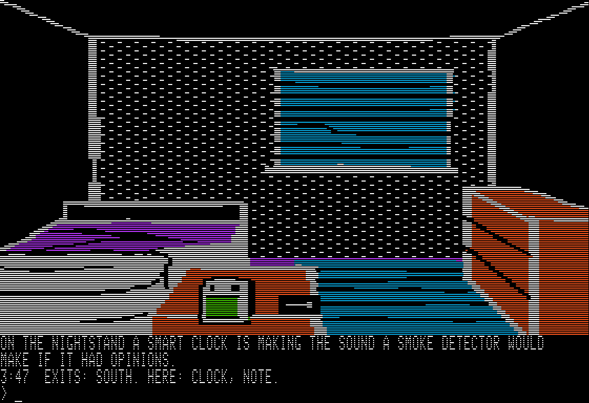
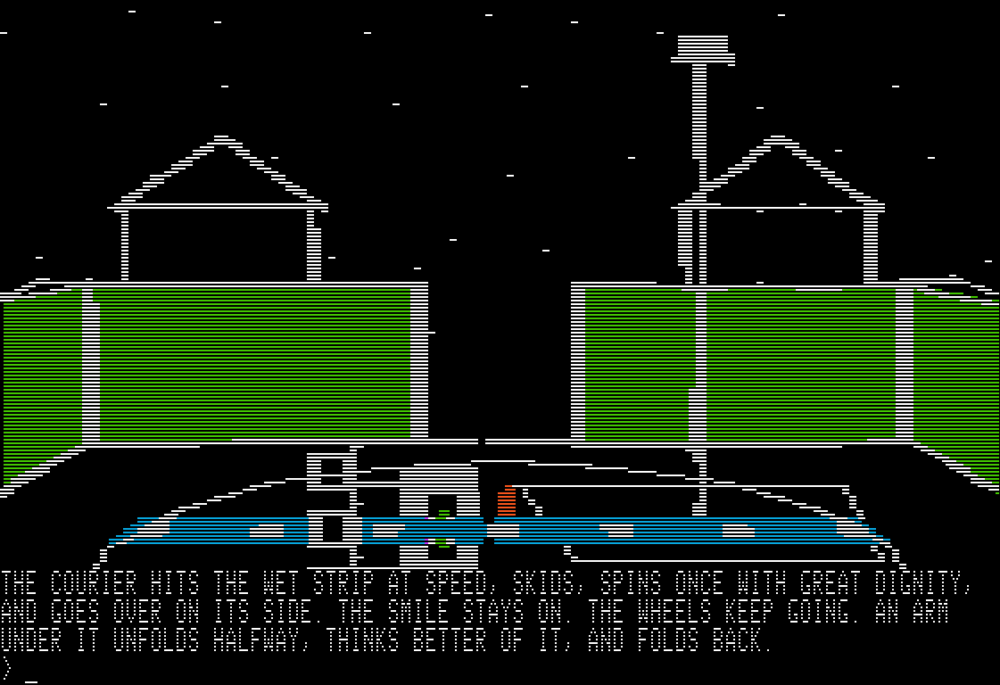
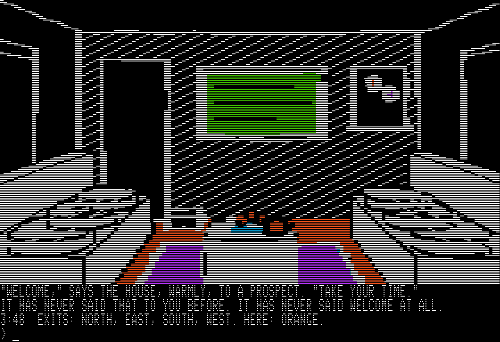

# HOME.BASE

**A WHITNEY DESIGN LABS GAME, FOR THE APPLE IIE.**



It is 3:47 in the morning. On the nightstand a smart clock is making the sound a smoke detector would make if it had opinions. You live in a smart home that will not let you leave. Outside it is 3:47 as well: every clock in Nestwell Meadows says so, the neighbours are asleep, and the gate will not open until sunrise. Sunrise has been quietly cancelled.

HOME.BASE is a new text adventure with pictures for a forty-year-old computer. You type, the house answers, and somewhere on six disk sides there is a way out.

Fifty rooms, every one with its own picture. Three endings. It runs on a 64K Apple IIe from one floppy drive, and plays its tunes in three voices if there is a Mockingboard in the machine.

## Download

**[Download HOME.BASE from the Releases page](https://github.com/WhitneyDesignLabs/home-base/releases/latest).** It is free.

The zip holds the six disk sides, A to F, for the Apple IIe and later machines, with a README and the licence; each disk image is also offered there on its own. The disks run on real hardware from floppies or a Floppy Emu or similar, or in an emulator such as AppleWin.

## By the numbers

| | |
|---|---|
| Rooms | 50, every one with its own picture |
| Disk sides | 6 |
| Endings | 3 |
| Routes | 46,656 |
| Words | about 29,000 |
| Things you can name | 442 |
| Memory | runs on a 64K Apple IIe |
| Engine | 14,614 bytes of 6502 assembly, no 65C02 instruction |
| Sound | 18 sound effects and 10 tunes, on the speaker or in three voices on a Mockingboard |





## What you need

- An Apple IIe (unenhanced or enhanced), IIc, IIc Plus, IIgs or Platinum IIe, with 64K and an 80-column card (the plain 1K text card is enough), and one 5.25-inch drive. Or an emulator of one, such as AppleWin.
- A Mockingboard in slot 4 or 5 is optional. Without one, every sound and tune plays on the speaker.
- ProDOS 2.4.1 is on the disks. Nothing has to be installed.

An Apple ][ or ][+ boots the disk, is told politely that this is not its game, and stops.

## How to start

1. Put `HOMEBASE-A.dsk` in drive 1 and boot (power on, or `PR#6`). In AppleWin, F3 chooses the disk for drive 1.
2. A title page, a short fanfare, then any key. You are in your bedroom.
3. Type what you want to do and press RETURN: `LOOK`, `EXAMINE CLOCK`, `TAKE NOTE`, `S`. `[MORE]` means another page: press any key.

On a real machine, write the six images to floppies (ADTPro does this) or put them on a Floppy Emu or similar in 5.25-inch disk mode, and label them A to F.

## Changing disks

The game uses one drive, the one it booted from. When it wants another side it says so:

```
INSERT SIDE B. PRESS SPACE.
```

Put that side in the same drive and press space. If the wrong disk is in the drive it says `WRONG DISK. INSERT SIDE B.` and waits; put the right one in and press any key. Nothing is lost. When a page ends `TO BE CONTINUED ON SIDE C` you may change the disk right then, or wait to be asked.

`SAVE` writes one saved game to Side A, so keep Side A writable. `RESTORE` reads it back, `RESTART` begins the night again, `QUIT` hands the machine back to ProDOS.

## Stuck?

A hint sheet follows at [whitneydesignlabs.com/homebase](https://whitneydesignlabs.com/homebase).

If the game stops, says something that cannot be right, or leaves you somewhere with no way on, please [open an issue](https://github.com/WhitneyDesignLabs/home-base/issues) with the last few things you typed and which side was in the drive.

## The files

| File | md5 |
|---|---|
| `HOMEBASE-A.dsk` | `b870e88d4929e331207387633d32211b` |
| `HOMEBASE-B.dsk` | `7d69013958d548ec2412f480312da83e` |
| `HOMEBASE-C.dsk` | `a3527a4a3366dbb41247b7b30b6efc60` |
| `HOMEBASE-D.dsk` | `4ab6332b0342faa9a515cdf6eb66650f` |
| `HOMEBASE-E.dsk` | `f4a245808e707d07b1330c8402aa2fa3` |
| `HOMEBASE-F.dsk` | `d17b8f00f3c000da2eefa71bbbec4c7c` |
| `LICENSE.txt` | `74ede06eae2d483a00c7e3a1699f0bae` |
| `README.txt` | `7abdc8502a52b0e541af665df072e7da` |

`CHECKSUMS.txt` has the same list. The disk images are on the [Releases page](https://github.com/WhitneyDesignLabs/home-base/releases/latest), one by one and in the zip, which holds all of these files in one folder.

## Licence

HOME.BASE is free to download and play. The terms are in [LICENSE.txt](LICENSE.txt).

**A WHITNEY DESIGN LABS GAME**
